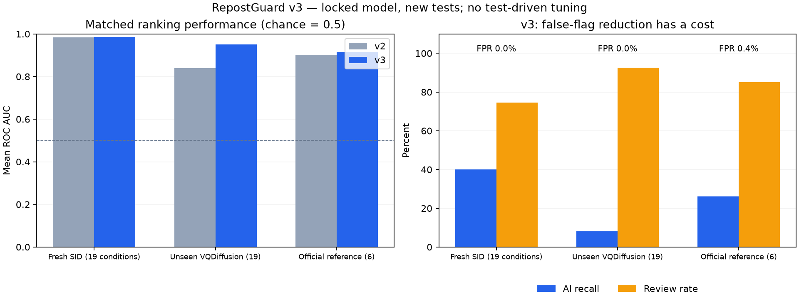

# v3 matched evaluation

Post-deadline research, never a competition submission. Model and thresholds were locked before the new test was scored.

Selected on development only: `candidate`. Model SHA256: `39f1b9c6cf6ddeb908232bf4faf7d089f03fa4b5f9416e3c870ba85508f09d92`.

The exact [pre-test artifact](frozen_pretest.joblib) is archived. Packaging only corrects inherited documentation fields; [preflight](preflight.json) verifies identical estimator, inference policy and sealed predictions, and records both artifact checksums.

## Domain summaries

Means below are descriptive averages over conditions, not independent trials. v2/v3 use exactly the same originals within each row. Domains have different transform counts. Community Forensics inputs are uniformly fit to 512x512 before transforms; those scores do not describe native source files.

| Domain | Originals/condition | Model | Mean AUC | Worst AUC | FPR | Recall | Review rate |
|---|---:|---|---:|---:|---:|---:|---:|
| SID-Set fresh | 256 | v2 | 0.9846 | 0.9772 | 11.7% | 97.9% | 0.0% |
| SID-Set fresh | 256 | v3 | 0.9865 | 0.9792 | 0.0% | 40.1% | 74.7% |
| OwensLab/CommunityForensics-Small | 192 | v2 | 0.8403 | 0.7657 | 19.1% | 67.2% | 0.0% |
| OwensLab/CommunityForensics-Small | 192 | v3 | 0.9501 | 0.9019 | 0.0% | 8.2% | 92.5% |
| WildFake reference | 400 | v2 | 0.9013 | 0.7576 | 14.7% | 75.7% | 0.0% |
| WildFake reference | 400 | v3 | 0.9160 | 0.7924 | 0.4% | 26.2% | 85.1% |

v2 uses its original binary 0.5 threshold. v3 uses a calibrated three-way policy. Lower FPR can cost recall and coverage; review cases are abstentions, not correct predictions.

## Fixed 0.5 threshold diagnostics

These diagnostics separate changes to the model score from changes to the review policy. This is not the default v3 operating policy.

| Domain | Model | Mean accuracy | Mean FPR | Mean AI recall |
|---|---|---:|---:|---:|
| SID-Set fresh | v2 | 93.1% | 11.7% | 97.9% |
| SID-Set fresh | v3 | 93.6% | 7.9% | 95.1% |
| OwensLab/CommunityForensics-Small | v2 | 74.0% | 19.1% | 67.2% |
| OwensLab/CommunityForensics-Small | v3 | 85.3% | 5.5% | 76.1% |
| WildFake reference | v2 | 80.5% | 14.7% | 75.7% |
| WildFake reference | v3 | 82.4% | 22.5% | 87.2% |

## Selected conditions

| Domain | Condition | v2 AUC | v3 AUC [95% CI] | v3 FPR | v3 recall | v3 review |
|---|---|---:|---:|---:|---:|---:|
| SID-Set fresh | clean | 0.9863 | 0.9907 [0.9813, 0.9975] | 0.0% | 37.5% | 77.0% |
| SID-Set fresh | resize_0.25 | 0.9832 | 0.9795 [0.9650, 0.9911] | 0.0% | 34.4% | 80.5% |
| SID-Set fresh | jpeg_30 | 0.9849 | 0.9863 [0.9756, 0.9949] | 0.0% | 43.0% | 73.4% |
| SID-Set fresh | noise_0.05 | 0.9849 | 0.9861 [0.9728, 0.9956] | 0.8% | 41.4% | 74.2% |
| SID-Set fresh | crop_resize_jpeg | 0.9830 | 0.9856 [0.9735, 0.9955] | 0.0% | 28.9% | 76.6% |
| SID-Set fresh | double_repost | 0.9772 | 0.9810 [0.9664, 0.9923] | 0.0% | 47.7% | 74.6% |
| OwensLab/CommunityForensics-Small | clean | 0.8978 | 0.9771 [0.9590, 0.9919] | 0.0% | 5.2% | 92.7% |
| OwensLab/CommunityForensics-Small | resize_0.25 | 0.7903 | 0.9251 [0.8866, 0.9597] | 0.0% | 7.3% | 93.8% |
| OwensLab/CommunityForensics-Small | jpeg_30 | 0.8258 | 0.9514 [0.9199, 0.9810] | 0.0% | 29.2% | 84.9% |
| OwensLab/CommunityForensics-Small | noise_0.05 | 0.8762 | 0.9658 [0.9398, 0.9868] | 0.0% | 1.0% | 94.8% |
| OwensLab/CommunityForensics-Small | crop_resize_jpeg | 0.7657 | 0.9019 [0.8569, 0.9450] | 0.0% | 8.3% | 94.3% |
| OwensLab/CommunityForensics-Small | double_repost | 0.8001 | 0.9342 [0.8965, 0.9685] | 0.0% | 22.9% | 88.0% |
| WildFake reference | clean | 0.9707 | 0.9813 [0.9679, 0.9913] | 0.0% | 26.5% | 82.8% |
| WildFake reference | resize_0.25 | 0.7576 | 0.7924 [0.7471, 0.8344] | 2.5% | 27.5% | 85.0% |
| WildFake reference | jpeg_30 | 0.9220 | 0.9364 [0.9089, 0.9582] | 0.0% | 20.5% | 86.8% |
| WildFake reference | noise_0.05 | 0.9745 | 0.9686 [0.9516, 0.9832] | 0.0% | 24.5% | 86.0% |
| WildFake reference | crop_resize_jpeg | 0.8825 | 0.8958 [0.8643, 0.9235] | 0.0% | 24.5% | 87.5% |
| WildFake reference | double_repost | 0.9004 | 0.9215 [0.8918, 0.9451] | 0.0% | 33.5% | 82.8% |

Full conditions: [evaluation.csv](evaluation.csv). Matched paired AUC-difference intervals: [paired_auc.csv](paired_auc.csv). Source roles and hashes: [data_manifest.json](data_manifest.json).

## Full synthesis versus local edits

The historical SID development guard samples by binary label, not by tampered subtype; its easy synthetic rows must not stand in for local-edit performance. New-test subtype diagnostics are reported separately, never used to change the locked model.

| New SID task | Model | Mean AUC | Worst AUC | AI recall at shipped policy |
|---|---|---:|---:|---:|
| SID-Set fresh (fully synthetic) | v2 | 0.9870 | 0.9789 | 97.9% |
| SID-Set fresh (fully synthetic) | v3 | 0.9946 | 0.9868 | 57.9% |
| SID-Set fresh (tampered) | v2 | 0.9821 | 0.9714 | 97.8% |
| SID-Set fresh (tampered) | v3 | 0.9784 | 0.9615 | 22.4% |

## Error analysis

Representative mistakes are listed in [error_analysis.json](error_analysis.json), with one case per original per mistake category. False-clear/false-flag errors use the shipped review policy; false negatives at 0.5 are separately labelled diagnostics.

Low confidence does not prove authenticity. Small real-image test groups cannot certify a universal 1% FPR. The held-out generator and real-source choices are narrow; acquisition/content bias and unseen pretraining overlap can remain. SID uses COCO-derived captions/edits: no protected reference is deliberately sampled for training, but shared parent photos cannot be ruled out. Bitmap deduplication is not parent-photo disjointness.

## Licensing and provenance

CommunityForensics-Small is CC-BY-NC-SA-4.0. The v3 artifact is for non-commercial research; do not infer commercial usage rights from this public repository. Dataset images are not redistributed. SID-Set is CC-BY-4.0.

The historical v2 cache had 4,003 repeated training files and 19 train/validation overlaps. Those historical metrics remain diagnostics only. v3 excludes training matches and uses fresh, sealed tests. See [protocol](../../docs/v3_protocol.md).
