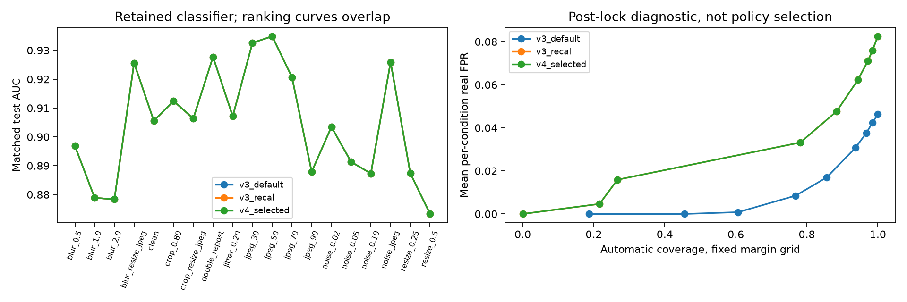

# V4: bounded CPU experiments

Development selection: **v3_recal**. Eligible new heads: [].
The pretest head and both policies were locked before the new 384-original test was extracted.
V3 remains the default throughout this research iteration. Neither historical nor new test labels train/calibrate/select the head.
The selected fallback is exactly the independently recalibrated V3 baseline. Its duplicated rows preserve the comparison schema; they are not independent new models or trials.

| Model / policy | Mean AUC | Mean FPR | AI flag recall | False clear | Review |
|---|---:|---:|---:|---:|---:|
| v3_default / v3_frozen_strict | 0.9044 | 0.00% | 15.0% | 0.33% | 87.2% |
| v3_recal / conditionwise | 0.9044 | 0.00% | 30.9% | 3.32% | 63.8% |
| v3_recal / strict | 0.9044 | 0.00% | 30.9% | 2.58% | 66.5% |
| v4_selected / conditionwise | 0.9044 | 0.00% | 30.9% | 3.32% | 63.8% |
| v4_selected / strict | 0.9044 | 0.00% | 30.9% | 2.58% | 66.5% |

## Paired mean-AUC differences versus V3 default

Bootstrap resamples independent originals within each label, retaining all paired conditions. These are descriptive condition means, not 19 independent experiments.

- all: +0.0000, 95% CI [+0.0000, +0.0000].
- SID: +0.0000, 95% CI [+0.0000, +0.0000].
- CF_StyleGANXL: +0.0000, 95% CI [+0.0000, +0.0000].
- SID_tampered: +0.0000, 95% CI [+0.0000, +0.0000].

## Scope and limitations

- Calibration samples two conditions only. The remaining final-test transformations are out-of-calibration stress tests.
- Development previews reuse probability-fit groups and are not error certification. The unique head is chosen before independent final-policy groups are scored; no candidate switch follows final calibration.
- Original-count bounds assume independent/exchangeable originals within the sampled distribution; source/parent/subject dependence can violate that assumption.
- Conditionwise bounds are pointwise, not a simultaneous or any-view guarantee. The strict policy counts an original wrong if any sampled view is wrong.
- A calibration-supported bound is not a deployment certification. Real test sample counts cannot certify 1% even with no false flags.
- CF uses identical 512x512 bicubic fit for both labels; native CLI geometry differs. FFHQ/landscape and generator/content acquisition bias can remain.
- Only new CF fake model names are role-disjoint. Real-source families repeat; SID generators are not certified disjoint. StyleGAN2 was already training data, so StyleGANXL is a named-generator holdout, not an entire StyleGAN-architecture holdout.
- Local pooled patch descriptors are experimental image-level features, not validated localization/explanations.
- SID tampered images retain their source-level AI-positive label after transforms. Crops may remove edited regions; no mask-based post-transform relabeling is applied.
- The color-jitter preset is the +20% side, not a full brightness/contrast/saturation Cartesian sweep.
- Protected bitmap/near exclusion cannot prove disjoint SID/COCO parent photographs or unknown encoder pretraining.
- CommunityForensics-Small is CC-BY-NC-SA-4.0: non-commercial research only. No source images or large feature caches are published.
- No TechJam submission, placement, live moderation deployment, or universal robustness is claimed.

[Protocol](../../docs/v4_protocol.md) · [Selection and all failed trials](selection.json) · [Head CV](head_trials.json) · [Per-condition table](evaluation.csv) · [Error cases](error_analysis.json)

